<p align="center">
  
</p>

<h1 align="center">Wallet Web Personal</h1>

<p align="center">
  Tu plata, en tu base de datos, con la app que vos controlás.<br />
  Finanzas personales para una sola persona: cuentas, tarjetas, metas, deudas, inversiones y
  los avisos del banco entrando solos.
</p>

<p align="center">
  <a href="https://github.com/srodriguez-lefebre/wallet-web-personal/actions/workflows/ci.yml"></a>
  
  
  
  
</p>

<p align="center">
  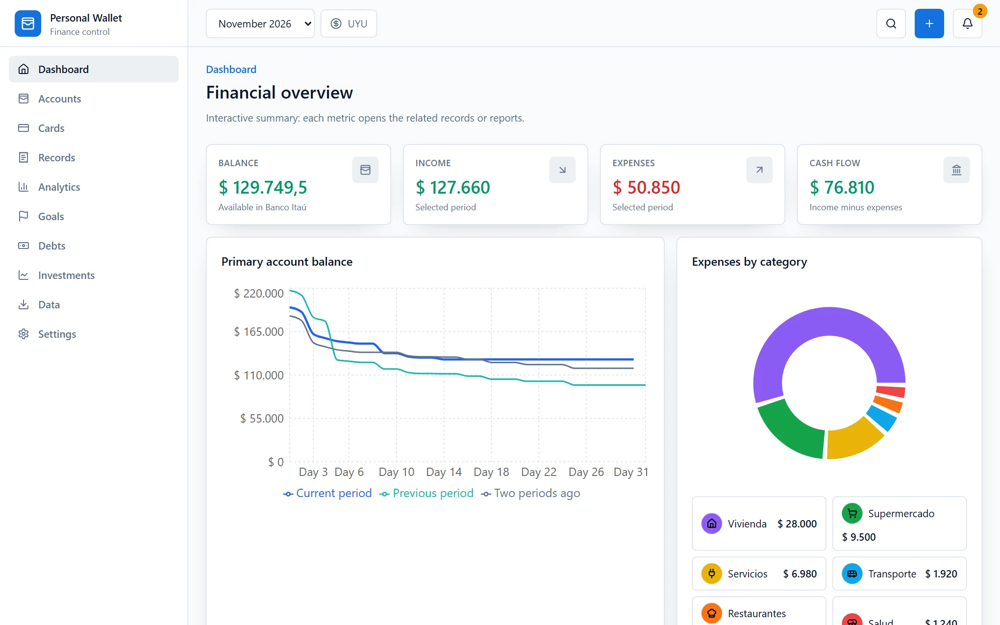
</p>

---

## ¿Por qué otra wallet?

Las apps de finanzas personales te piden la clave del banco, viven de tus datos o desaparecen
con un cambio de modelo de negocio. Esta no:

- **Es tuya y de nadie más.** Un solo usuario, un token, tu propia base PostgreSQL. No hay
  registro, no hay terceros mirando tus movimientos.
- **Entra sola.** Los avisos que el banco manda por correo se convierten en movimientos sin que
  escribas nada. Lo que no se puede resolver con certeza queda marcado para revisar; nunca se
  inventa una categoría ni una cotización.
- **Entiende varias monedas.** Pesos, dólares, euros, reales y pesos argentinos. Cada movimiento
  congela la cotización del día para que el historial no cambie cuando cambia el dólar.
- **Entra en los planes gratis.** Una Serverless Function en Vercel y una base en Neon alcanzan
  de sobra para el uso de una persona.
- **No pierde historial.** Nada se borra de verdad: cuentas, tarjetas, categorías y movimientos
  se archivan y siguen contando donde corresponde.

## Probala en dos minutos

Sin cuenta, sin base externa, sin credenciales. El entorno de demostración aplica las migraciones
reales sobre un PostgreSQL en memoria y levanta la API y la interfaz reales con datos sintéticos.

```powershell
npm install
npx tsx scripts/sandbox/qa.ts
```

Abrí <http://127.0.0.1:4175> y entrá con el código `wallet-local-test`. Lo que cambies sobrevive a
una recarga y desaparece cuando detenés el servidor (`Ctrl+C` o `POST /__qa/stop`). Las
conexiones externas están bloqueadas.

<p align="center">
  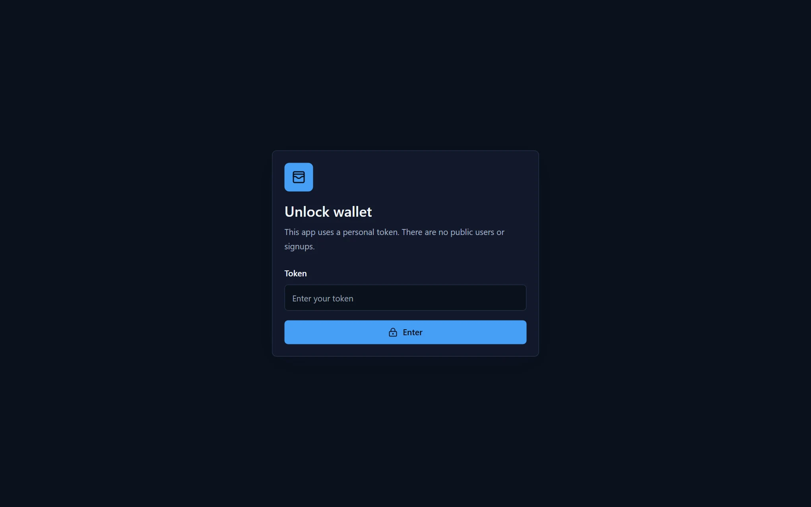
</p>

### Instalá la tuya

Necesitás una cuenta gratuita en [Vercel](https://vercel.com) y otra en [Neon](https://neon.tech).

1. Creá un proyecto en Neon y copiá la cadena de conexión.
2. Importá este repositorio en Vercel.
3. Configurá las variables de entorno del proyecto:

   | Variable           | Para qué                                                                  |
   | ------------------ | ------------------------------------------------------------------------- |
   | `DATABASE_URL`     | Conexión a Neon.                                                          |
   | `API_TOKEN`        | Tu token personal; es lo que escribís para desbloquear la app.            |
   | `SESSION_SECRET`   | Secreto independiente para firmar las sesiones del navegador.             |
   | `INGEST_API_TOKEN` | Opcional. Token exclusivo para la ingesta de correos.                     |
   | `OPENAI_API_KEY`   | Opcional. Clasifica comercios desconocidos; sin ella quedan para revisar. |

4. Aplicá las migraciones contra tu base (`npm run db:migrate`) y deployá.

Las sesiones duran 45 días y el navegador guarda sólo la sesión firmada, nunca el token.
Cinco intentos fallidos por IP en quince minutos bloquean el desbloqueo. El resto de los
procedimientos (sandbox con tu respaldo, importación de datos, migraciones delicadas, rotación de
secretos, Apps Script) está en [OPERATIONS.md](OPERATIONS.md).

## Qué tiene

### Movimientos con cola de revisión

Todo pasa por acá: gastos, ingresos y transferencias entre cuentas, con categoría, comercio,
etiqueta, notas y medio de pago. Los filtros combinan período, cuenta, tarjeta, categoría y
estado, y la búsqueda global (`Ctrl/Cmd+K`) encuentra cualquier cosa ignorando mayúsculas y
acentos. Los movimientos que llegaron por correo sin categoría o sin cotización quedan en una cola
de revisión propia, independiente del período, que avisa cuántos hay nuevos. Las plantillas guardan
configuraciones repetidas (la nafta quincenal, el alquiler) y las abren como borrador con la fecha
y las cotizaciones de hoy.

<p align="center">
  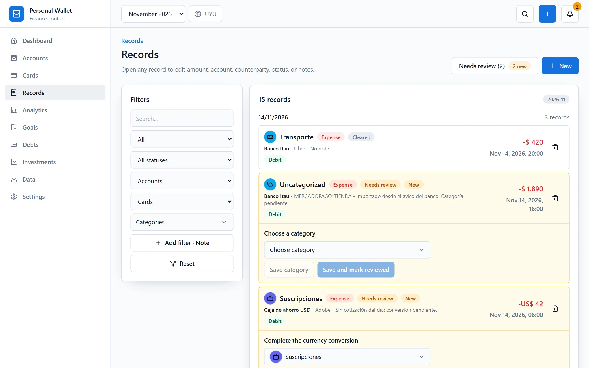
</p>

### Cuentas en varias monedas

Cada cuenta tiene su moneda, su saldo disponible y lo que está reservado para metas. El saldo
total y el disponible se calculan en el servidor con las cotizaciones congeladas de cada
movimiento. Las cuentas se pueden ocultar de los reportes o archivar sin perder su historial.

<p align="center">
  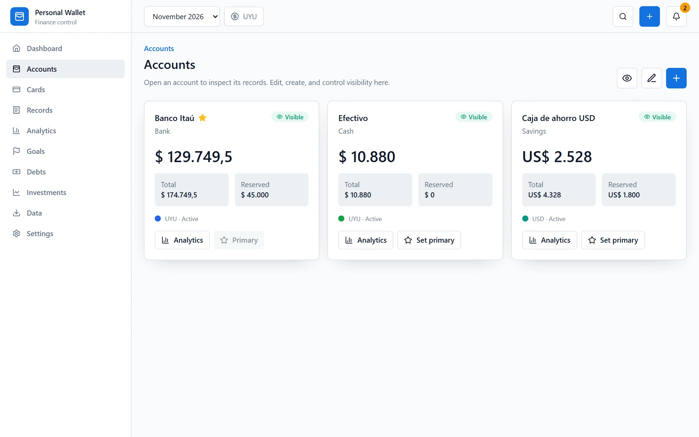
</p>

### Tarjetas de crédito con ciclos reales

Las compras con tarjeta no tocan el saldo del banco hasta que pagás el resumen. Cada tarjeta
tiene su límite, su día de cierre y su día de vencimiento; la app arma los ciclos, cierra los
resúmenes, distingue el ciclo abierto de los resúmenes pendientes y avisa al 80 % y al 100 % del
límite. Las compras en otra moneda guardan la conversión usada para consumir el límite, y los
pagos se aplican contra un resumen concreto, descontando de una cuenta o como pago externo.

<p align="center">
  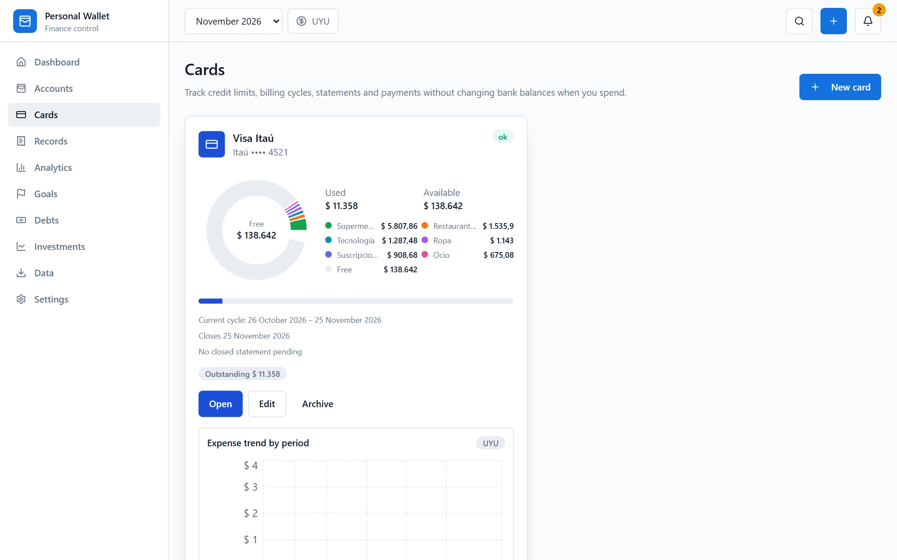
</p>

<p align="center">
  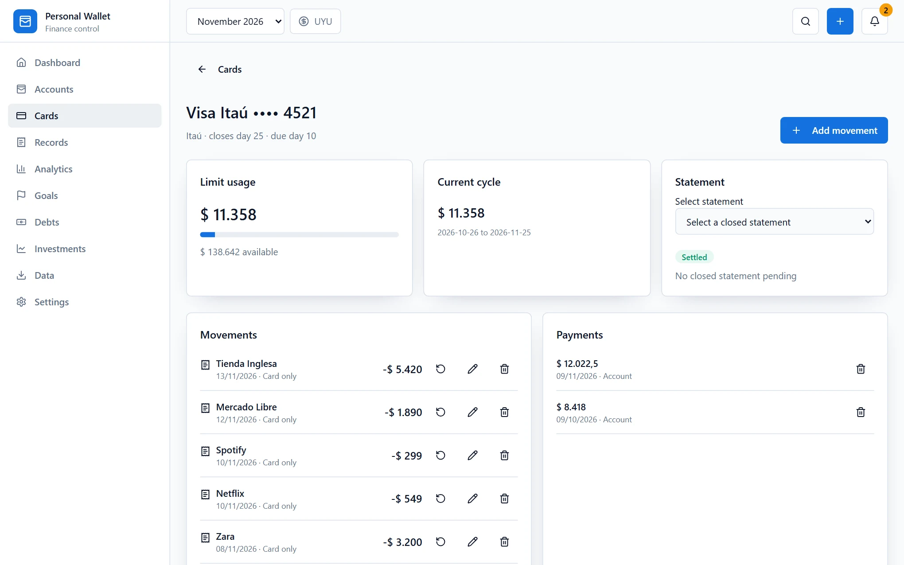
</p>

### Análisis que responde preguntas

Tasa de ahorro, meses de colchón, promedio diario, tendencia de gastos comparada con los dos
períodos anteriores, comparación mensual, gastos por categoría y por cuenta, comercios principales
y evolución del saldo. Todo sale de agregados SQL, así que no hace falta descargar el historial
para ver un reporte. El asistente de presupuestos propone límites mensuales a partir de los tres
meses anteriores y deja editar cada importe antes de guardarlo.

<p align="center">
  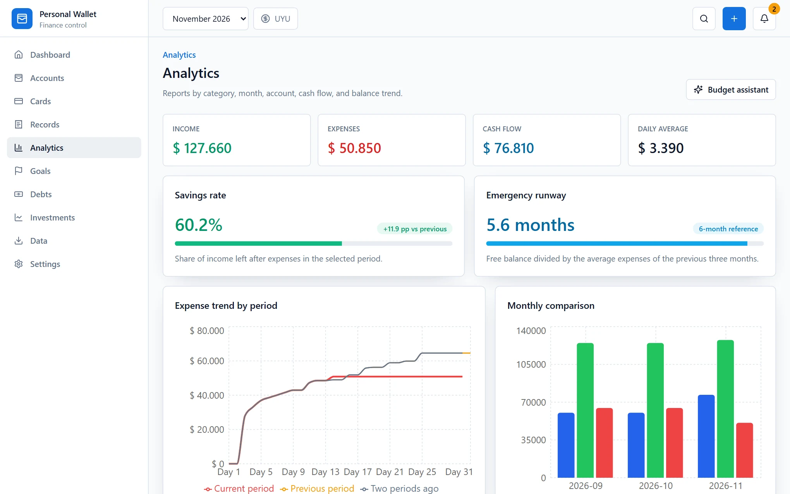
</p>

### Metas, deudas, inversiones y cuotas

- **Metas:** reservás plata de una cuenta para una meta y la app te dice cuánto falta y cuánto
  aportar por día o por semana hasta la fecha. Completar una meta libera lo que sobró a las
  cuentas originales.
- **Deudas:** lo que debés y lo que te deben, con pagos parciales que crean movimientos, deudas
  recurrentes mensuales y filtros por vencidas, próximos 7 y 30 días.
- **Inversiones:** cartera por moneda con costo, valor actual y resultado.
- **Cuotas:** planes de pago en cuotas con avance y próxima fecha.

<table>
  <tr>
    <td>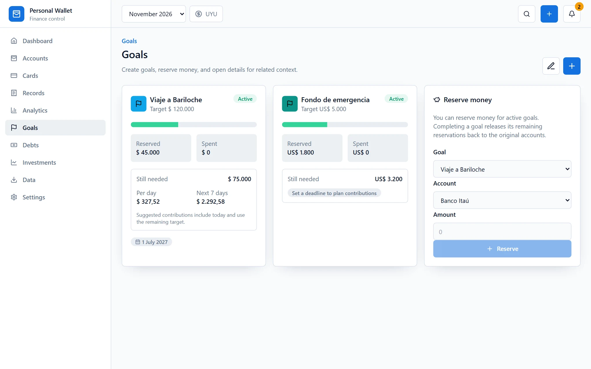</td>
    <td>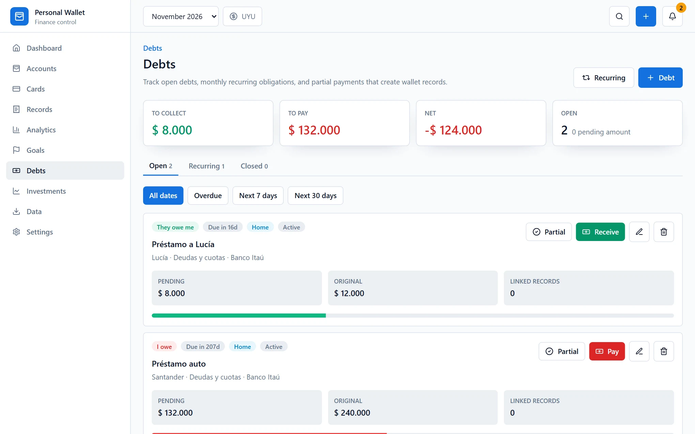</td>
  </tr>
  <tr>
    <td>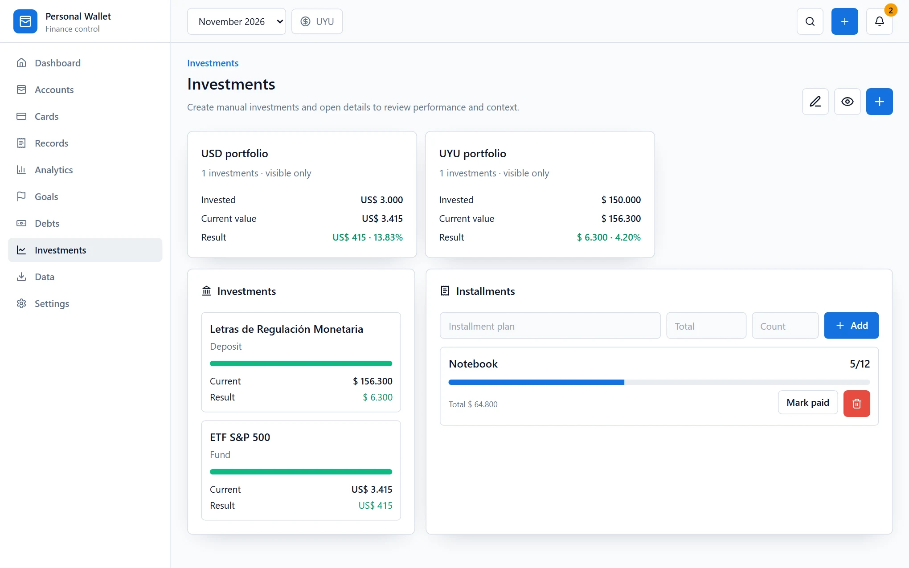</td>
    <td>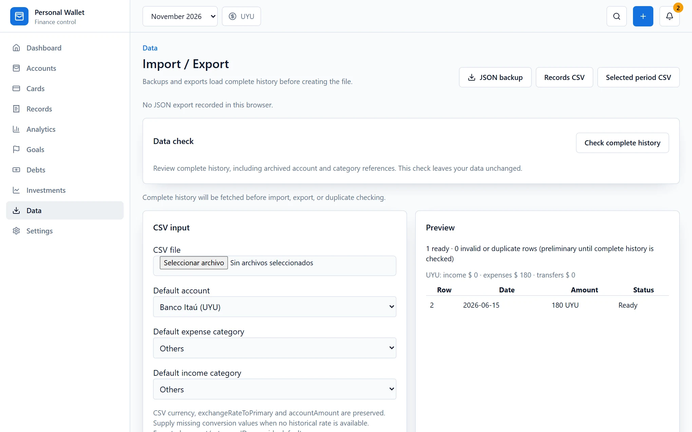</td>
  </tr>
</table>

### Tus datos entran y salen

Importás un CSV con vista previa, detección de duplicados y lotes atómicos de hasta 200 filas.
Exportás un respaldo JSON completo (incluye archivados, reservas, reglas de comercios y claves de
procesamiento) y lo restaurás de forma atómica: si algo no valida, la base queda como estaba. La
verificación de datos revisa referencias, conversiones y categorías de todo el historial sin
modificar nada.

### Los avisos del banco entran solos

Un Google Apps Script lee en tu Gmail los avisos de compra, débito, transferencia y pago, los
normaliza con el mismo código que usa el servidor y los envía a la API con un token exclusivo. El
servidor reconoce el comercio, elige la categoría (reglas aprendidas primero, OpenAI sólo para
comercios nuevos), resuelve la cuenta o tarjeta destino, descarta duplicados y guarda el
movimiento. Si falta un dato o un proveedor externo no responde a tiempo, el movimiento queda
para revisar con su importe intacto.

### Claro, oscuro y en el teléfono

<table>
  <tr>
    <td colspan="2">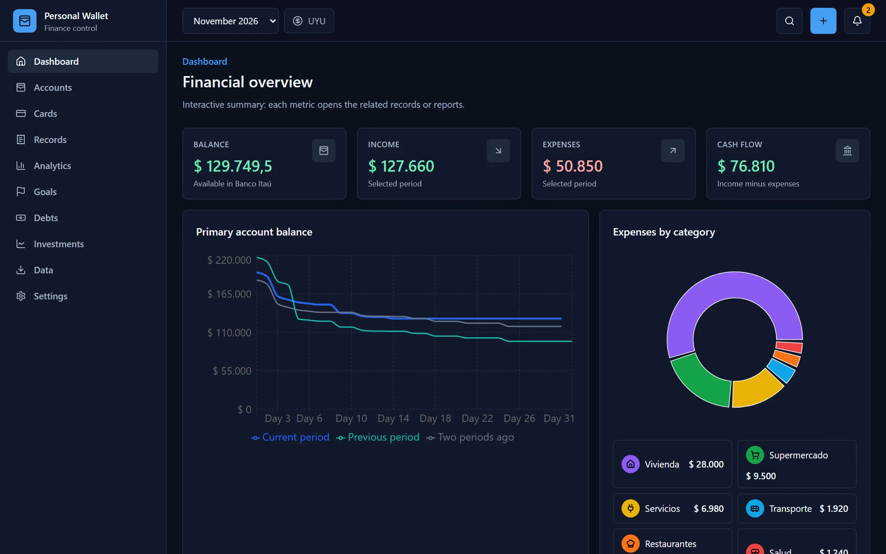</td>
    <td>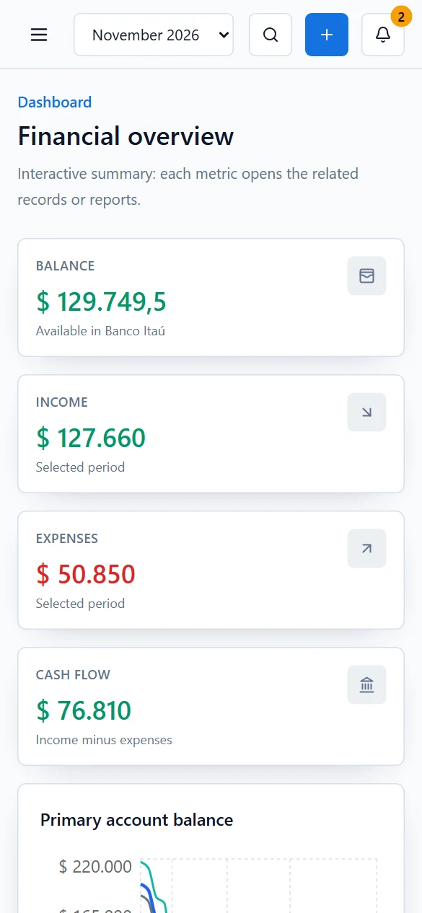</td>
  </tr>
</table>

### Seguridad pensada para una sola persona

- Un token maestro que nunca viaja al navegador: el desbloqueo devuelve una sesión firmada con
  vencimiento.
- Bloquear la app aborta las solicitudes en curso y borra las cachés; no queda información
  financiera en `localStorage`.
- Límite de intentos de desbloqueo por IP y global, con poda automática.
- La ingesta de correos usa su propio token y no acepta la sesión del usuario.
- Los logs del servidor registran operación, estado y duración; nunca cuerpos, parámetros SQL ni
  importes.
- Sesiones revocables (cerrar todas las sesiones desde Ajustes) ya implementadas, a activar con
  una variable de entorno.

## Cómo está hecho

### Stack

| Capa          | Tecnología                                                                           |
| ------------- | ------------------------------------------------------------------------------------ |
| Interfaz      | React 19, Vite 7, TypeScript 5.9, Tailwind CSS, Radix UI, Recharts, React Router 7   |
| Estado remoto | TanStack Query 5 con claves por entidad y políticas de invalidación por mutación     |
| Contratos     | Zod 4 en `shared/`, contrato de rutas tipado, OpenAPI generado                       |
| Backend       | Una Serverless Function en Vercel (`api/index.ts`), Node 22                          |
| Base de datos | Neon PostgreSQL, Drizzle ORM, driver Neon HTTP, 24 migraciones versionadas           |
| Ingesta       | Google Apps Script + parsers TypeScript compartidos, OpenAI y Frankfurter opcionales |
| Pruebas       | Vitest, PostgreSQL embebido para integración, PGlite para sandbox y QA, jsdom        |
| Calidad       | Prettier, ESLint con reglas tipadas e `import/order`, `npm run check` en CI          |

### Arquitectura

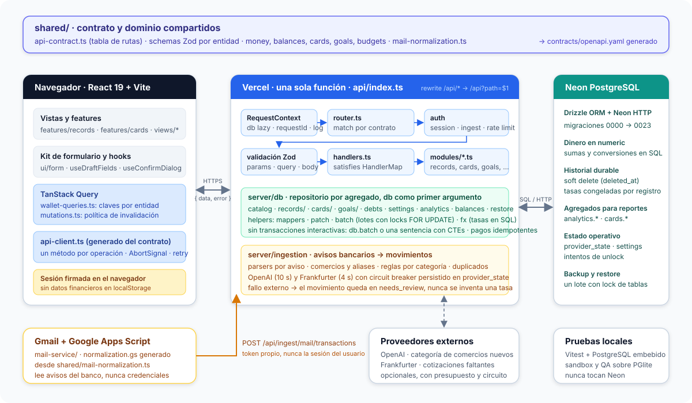

Tres decisiones explican casi todo lo demás:

1. **El contrato es la fuente de verdad.** `shared/api-contract.ts` declara las 90 operaciones:
   método, ruta, nivel de autenticación, esquemas de entrada y salida y código de éxito. De ahí se
   deriva el router del servidor, el cliente del navegador y `contracts/openapi.yaml`. Agregar una
   operación sin su handler o sin su política de caché no compila.
2. **Una sola función, un pipeline fijo.** Cada request construye un contexto (una conexión lazy,
   `requestId`, una línea de log), encuentra la operación, autentica antes de leer nada privado,
   valida con Zod, ejecuta el handler y responde `{ data, error }`.
3. **El dinero vive en SQL.** Importes en `numeric`, sumas y conversiones en consultas, reportes
   como agregados. Neon HTTP no tiene transacciones interactivas, así que cada mutación de varios
   pasos es un lote o una sola sentencia con CTEs, y los pagos llevan clave de idempotencia.

### Ciclo de una request

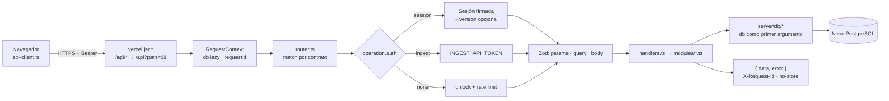

### Datos en el navegador

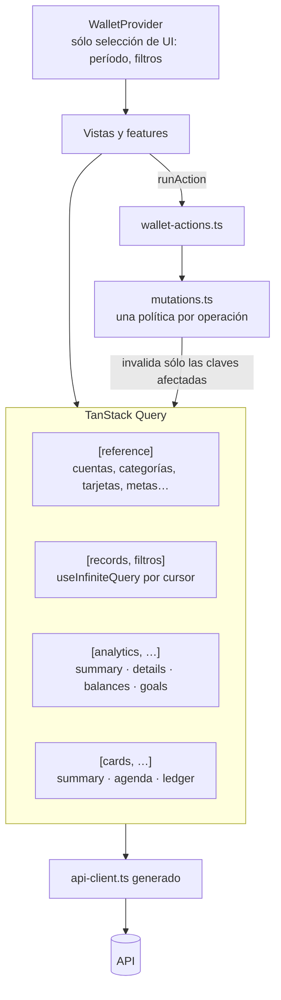

El arranque siembra la referencia y la primera página de movimientos. Ninguna vista trata una
página como si fuera todo el historial; los saldos, metas, reportes y tarjetas consumen agregados
completos del servidor. Los formularios comparten un kit (`Field`, `MoneyInput`, `CurrencySelect`,
`AccountSelect`, `CategoryField`, `ConfirmDialog`, `FormDialog`) y los hooks `useDraftFields` y
`useConfirmDialog`.

### De un correo a un movimiento

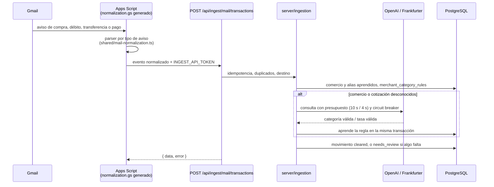

### Reglas del dominio que no se negocian

- `needs_review` conserva el impacto financiero de lo que se sabe; `cancelled` lo excluye. Nunca se
  supone una relación 1:1 entre monedas: una cotización de cero significa "pendiente".
- Soft delete en cuentas, categorías, etiquetas, tarjetas, movimientos, pagos, deudas,
  presupuestos, inversiones y planes de cuotas. El historial financiero es durable.
- La moneda principal, la de las cuentas y la del límite de las tarjetas quedan protegidas cuando
  ya hay historial, para no reinterpretar importes congelados.
- Las lecturas no escriben. Los ciclos de tarjeta se actualizan dentro de las mutaciones de
  tarjetas y con un endpoint explícito que el cliente llama al abrir Tarjetas.
- Pagos de deudas y tarjetas y movimientos de reservas llevan clave de idempotencia: un reintento
  no descuenta dos veces.
- Las tablas nuevas se agregan al respaldo y a la restauración; el estado operativo (circuitos,
  contadores de autenticación) no se restaura desde un JSON.

### Mapa del repositorio

```text
api/index.ts            Pipeline de la Serverless Function
server/api/             router, context, auth, sesiones, errors, modules/*.ts (handlers)
server/db/              Repositorio por agregado + mappers, patch, batch, fx, pg-error
server/ingestion/       parsers/, providers/ (category, rates, circuit), reglas de comercios
shared/                 api-contract.ts, schemas/ (Zod), cálculos de dominio, mail-normalization
src/features/           records/ y cards/ (vistas, hooks y formularios por dominio)
src/views/              dashboard, accounts, analytics, goals, debts, investments, data, settings
src/services/           api-client.ts (generado), wallet-queries.ts, mutations.ts, wallet-actions.ts
src/components/ui/form  Kit de formulario compartido
drizzle/migrations/     0000 → 0023, aditivas, con journal verificado
mail-service/           Apps Script (Code.gs, EmailProcessors.gs, normalization.gs generado)
scripts/sandbox/        Sandbox, QA sintético, PostgreSQL embebido para tests
contracts/openapi.yaml  Generado desde el contrato, verificado en CI
```

### Verificación

```powershell
npm run check
```

Corre, en orden, formato, lint con tipos, comprobación del bundle del Apps Script, 136 archivos
de pruebas, build y verificación del OpenAPI generado. Las pruebas levantan un clúster de
PostgreSQL embebido por ejecución y clonan una base plantilla por archivo; nunca tocan Neon.
`WALLET_TEST_WORKERS=1` fuerza un solo worker en máquinas chicas. CI ejecuta exactamente este
comando en cada push y pull request.

Comprobaciones seguras contra producción sin credenciales: `GET /api/health` responde `401` JSON
con `X-Request-Id`, una ruta desconocida bajo `/api/` responde `404` JSON del router y
`/api/records/<uuid>` responde `401` y no un 404 de Vercel.

### Lo que falta

- Activar las sesiones revocables en producción (requiere un `SESSION_SECRET` independiente y una
  ventana de transición).
- Clave foránea en `records.debt_id` y eliminación de la tabla legacy `goal_reservations`.
- Dividir las vistas grandes (deudas, ajustes, metas, inversiones) como ya se hizo con Movimientos
  y Tarjetas.
- Terminar de unificar el idioma de la interfaz.
- Una suite end-to-end en navegador; hoy la integración se prueba contra el router y el
  repositorio.

El detalle operativo (sandbox con respaldo propio, importadores, preflight de migraciones,
activación de sesiones revocables, despliegue del Apps Script) está en
[OPERATIONS.md](OPERATIONS.md).
